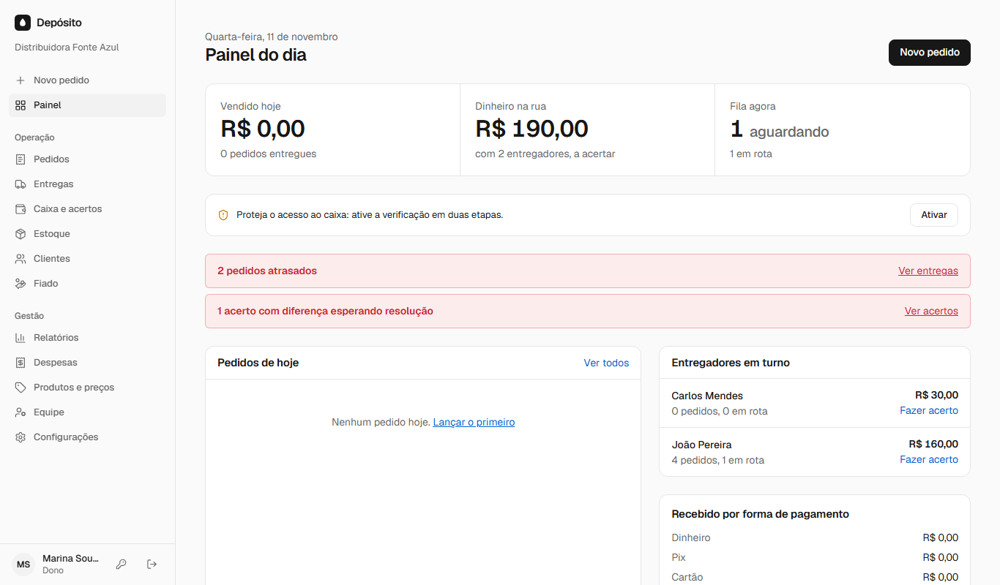
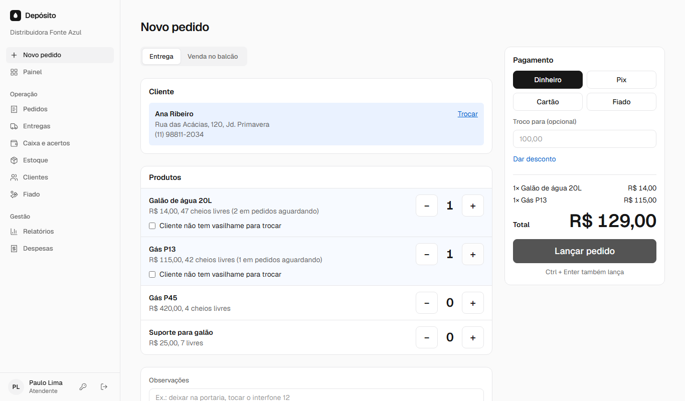
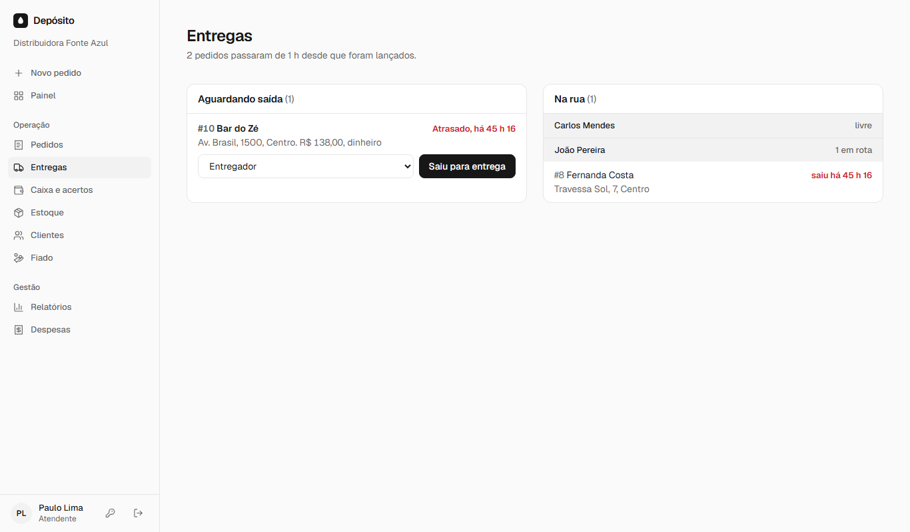
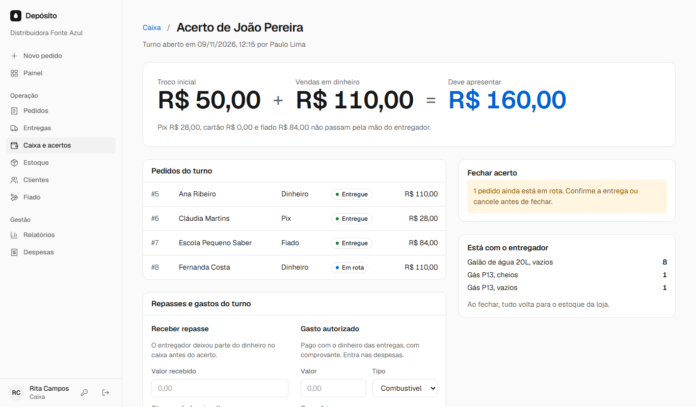
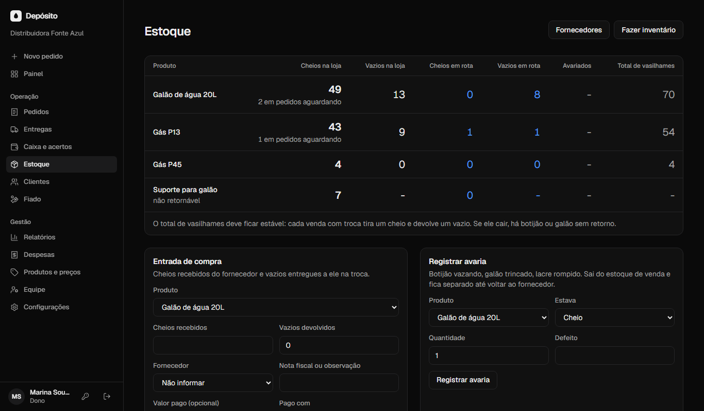
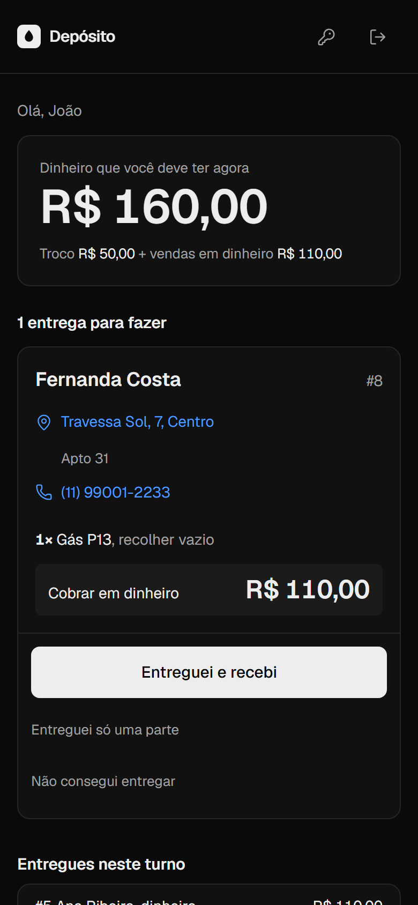
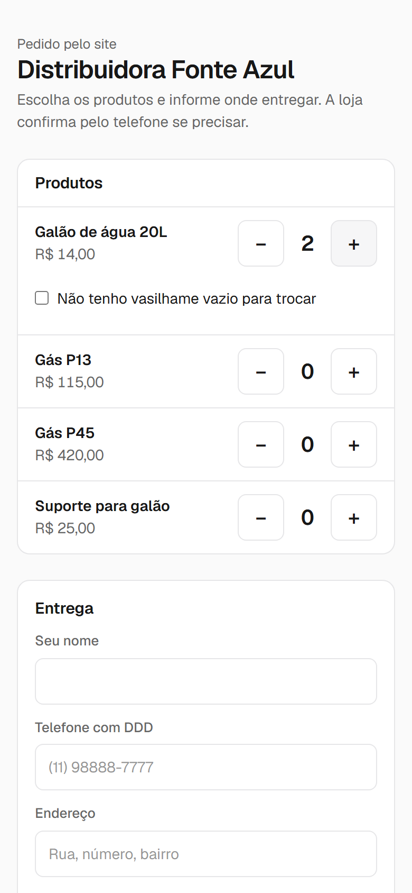

# Depósito

Sistema de gestão para distribuidoras de água e gás. Cobre o caminho inteiro de uma venda: o pedido que
chega pelo WhatsApp ou pelo site, a saída com o entregador, a entrega, o dinheiro que precisa voltar ao
caixa e o botijão vazio que precisa voltar ao estoque.

Feito pela [Solace](https://github.com/Solace-Inc-Team) para uma revenda real e desenhado desde o início
para atender várias empresas no mesmo banco, com os dados de cada uma isolados.



## O problema

Numa revenda de gás e água, o pedido chega por mensagem, o entregador sai com a mercadoria, recebe em
dinheiro e acerta no fim do dia. Quando o valor não fecha, ninguém sabe dizer se faltou uma entrega, um
troco ou um botijão. O sistema existe para que cada real e cada vasilhame tenham origem, responsável e
horário, sem depender de caderno.

## O que ele faz

**Pedidos e entregas**

- lançamento rápido com busca de cliente, atalhos de teclado e preço sempre vindo do cadastro;
- fila de entregas com o que espera, o que está com cada entregador e o que atrasou;
- entrega parcial (o total é refeito), tentativa sem sucesso (volta para a fila com o motivo) e troca de entregador;
- desconto com motivo e limite por perfil, pagamento misto, vários endereços por cliente;
- portal público por empresa, onde o próprio cliente faz o pedido e recebe o QR do Pix.

| Novo pedido | Fila de entregas |
|---|---|
|  |  |

**Caixa por entregador**

- turno com troco inicial, repasses durante o dia e gastos autorizados na rua;
- acerto conferido pelo caixa ou pelo dono, nunca por quem entregou;
- diferença não some: fica pendente até o dono registrar o que foi feito dela;
- Pix só conta como recebido depois de conferido no extrato.



**Estoque de retornáveis**

- cheios, vazios e avariados, na loja e com cada entregador;
- pedidos aguardando já reservam o que está na loja;
- inventário de tudo de uma vez, em que só as diferenças viram ajuste;
- fornecedores, e compra que já entra nas despesas.



**No celular**

O entregador vê só as entregas dele, quanto deve ter em dinheiro e um botão grande para confirmar, com
cinco segundos para desfazer. Sem sinal, a confirmação fica guardada no aparelho e segue sozinha depois.

| Entregador | Portal do cliente |
|---|---|
|  |  |

**Gestão**

Fiado com extrato e baixa, despesas, estorno de venda, relatórios por dia, entregador e produto,
fechamento do dia para imprimir, exportação de todos os dados em planilhas e um painel da Solace para
criar, suspender e excluir empresas.

## Perfis

| Perfil | Faz | Não faz |
|---|---|---|
| Dono | Tudo, mais preços, equipe, estornos, inventário e resolução de diferenças | |
| Caixa | O que o atendente faz, mais repasses, acertos e conferência de Pix | Resolver diferença, estornar |
| Atendente | Pedidos, clientes, entregas, entrada de estoque | Fechar acerto, dar desconto acima do limite |
| Entregador | Ver e confirmar as próprias entregas | Mudar preço, ver o caixa, acertar o próprio turno |

## Como é por dentro

Next.js 16 (App Router, server actions), TypeScript, PostgreSQL com Drizzle e Tailwind. É um monólito:
as regras ficam em `src/domain`, as telas chamam server actions e as actions chamam o domínio.

Decisões que valem a leitura do código:

- **Isolamento entre empresas em duas camadas.** Toda consulta filtra por empresa e, por baixo, o
  Postgres aplica Row-Level Security: cada requisição roda numa transação com um papel sem privilégios
  e a empresa fixada (`withTenant`, em [src/db/index.ts](src/db/index.ts)). Uma consulta que esqueça o
  filtro continua isolada, e há um teste que prova isso.
- **Saldo é soma de movimentos.** Estoque e caixa não têm campo de saldo para editar. O que existe são
  lançamentos que nunca são apagados; erro se corrige com estorno, e o histórico fica.
- **Dinheiro em centavos inteiros**, do banco à tela.
- **Concorrência tratada no banco.** Dois pedidos ao mesmo tempo não pegam o mesmo número nem o mesmo
  botijão, e um acerto não fecha no meio de um despacho (`SELECT ... FOR UPDATE` nos pontos certos).
- **Ações sem volta pedem a senha de novo:** estorno, ajuste de estoque, inventário e exclusão de dados pessoais.
- **Privacidade.** O dono exporta tudo, apaga os dados pessoais de um cliente a pedido dele, e a empresa
  que sai tem os dados excluídos com registro. Erros do servidor são guardados sem os valores das consultas.
- **Sem serviços externos obrigatórios.** Sessão, 2FA (TOTP) e o código Pix copia e cola são implementados
  aqui, com `node:crypto`.

```
src/
  domain/     regras: pedidos, turnos, estoque, fiado, despesas, portal, plataforma
  app/        telas e server actions ((app) escritório, entregador, pedir, admin)
  db/         schema, conexão com escopo por empresa, dados de demonstração
  lib/        cálculo de caixa, Pix, TOTP, CSV, sessão, limite de tentativas
drizzle/      migrações SQL, aplicadas na subida do servidor
e2e/          cenários de ponta a ponta
```

## Rodando

Precisa só de Node 24. O `npm run dev` sobe junto um Postgres local (`embedded-postgres`, dados em
`~/.gestao-emp/pg`), sem Docker.

```bash
npm install
cp .env.example .env.local
npm run dev
```

Com `SEED_DEMO=true` o primeiro start cria a "Distribuidora Fonte Azul", com pedidos, turnos e estoque.
Todos entram com a senha `demo1234`:

| Perfil | E-mail |
|---|---|
| Dono | dono@demo.com |
| Atendente | atendente@demo.com |
| Caixa | caixa@demo.com |
| Entregadores | joao@demo.com, carlos@demo.com |

O portal da demo fica em `/pedir/fonte-azul`. Com `ADMIN_EMAIL` e `ADMIN_PASSWORD` definidos, o start
também cria o acesso ao painel `/admin`. Para zerar o banco local, apague `~/.gestao-emp/pg`.

## Testes

```bash
npm test            # cálculo de caixa, Pix, 2FA, CSV
npm run test:db     # regras com Postgres de verdade: isolamento, caixa, estoque, fiado, portal
npm run test:e2e    # navegador: pedido até o acerto, fiado, portal e acesso por perfil
```

`test:db` e `test:e2e` usam o Postgres do `npm run dev` (ou o de `TEST_PG_URL`) e criam bancos próprios,
sem tocar nos dados de desenvolvimento. Na primeira vez, `npx playwright install chromium`.

## Publicação

Um `Dockerfile` e um Postgres bastam. O passo a passo para um VPS com Coolify, incluindo backup,
restauração testada e alertas, está em [DEPLOY.md](DEPLOY.md).

## O que ainda não tem

- baixa automática de Pix por webhook (hoje a conferência é manual, no extrato);
- cobrança da assinatura das empresas e filiais;
- comodato e caução de vasilhame;
- acompanhamento do pedido pelo cliente no portal;
- emissão fiscal, que fica com o sistema do contador.

Antes de usar com clientes reais, preencha os dados da empresa em `src/lib/legal.ts` e revise os termos
e a política de privacidade com um advogado.

## Licença

Código proprietário da Solace, publicado para consulta. Sem licença de uso ou redistribuição.
